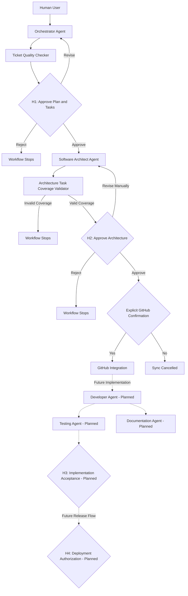

# AI Agent Organization

## 1. Purpose

This document describes the organization of agents and supporting components in the AI-Supported End-to-End Software Development Workflow.

The workflow aims to use AI agents to support the software development lifecycle (SDLC), from requirements analysis and project planning to architecture design, implementation, testing, and documentation.

The initial proof of concept uses the **AI-Powered Adaptive Exam Preparation System** as its pilot project.

The system follows a human-supervised approach. AI agents prepare plans and technical outputs, validation components check their results, and designated human approval checkpoints prevent the workflow from advancing without authorization.

## 2. Organizational Principles

The agent organization follows these principles:

- **Centralized coordination:** The Orchestrator coordinates the workflow and prepares work for specialized agents.
- **Specialization:** Each agent has a defined responsibility rather than performing every SDLC activity.
- **Validation:** Generated tasks and technical outputs are checked before the workflow advances.
- **Human oversight:** Important decisions require explicit human approval.
- **Traceability:** Requirements, tasks, architecture decisions, and GitHub Issues should remain connected.
- **Incremental implementation:** The proof of concept is developed in stages, starting with planning and architecture before extending to implementation and testing.

## 3. Agent Organization

### 3.1 Orchestrator Agent

**Status:** Implemented.

The Orchestrator is the central coordination component and the intended primary user-facing agent.

**Responsibilities:**
- Analyze the pilot project specification.
- Prepare a development plan.
- Convert the plan into structured development tasks.
- Validate the structure and dependencies of generated tasks.
- Support plan revision based on human feedback.
- Manage and record human approval decisions.
- Track approval state and check whether workflow prerequisites have been satisfied.
- Prepare the workflow for subsequent specialist activities.

**Assigned skills and capabilities:**
- Requirements analysis.
- Project planning.
- Task decomposition.
- Structured task generation.
- Dependency validation.
- Plan revision.
- Workflow coordination.
- Human approval management.

**Current implementation:** The Orchestrator is implemented in `agents/orchestrator.py`. Its planning and task-generation methods are used by `main.py`. Specialist delegation is not yet fully automated.

### 3.2 Software Architect Agent

**Status:** Implemented.

The Software Architect transforms the project specification and approved task backlog into a technical architecture proposal.

**Responsibilities:**
- Analyze the specification and approved tasks.
- Generate an architecture document.
- Describe the system structure, components, interfaces, data design, and technical recommendations.
- Map the architecture to the approved task IDs.
- Identify risks, open questions, and decisions requiring human review.

**Assigned skills and capabilities:**
- Software architecture design.
- Component decomposition.
- Interface and API design.
- Data design.
- Technology recommendation.
- Task-to-architecture mapping.
- Technical risk identification.

**Current implementation:** The agent is implemented in `agents/software_architect.py`. It generates `pilot/architecture_design.md` using the project specification and approved task backlog.

An additional task-coverage validator checks whether expected task IDs appear in the generated architecture and reports missing, unexpected, and repeated IDs. This is a structural check; it does not prove that each task has been fully or correctly implemented in the architecture.

### 3.3 Developer Agent

**Status:** Planned.

The Developer Agent will implement approved development tasks based on the project specification, architecture, and task acceptance criteria.

**Planned responsibilities:**
- Select or receive an approved task.
- Review its description, dependencies, and acceptance criteria.
- Implement the required code.
- Follow the approved architecture and project conventions.
- Provide implementation results for review and testing.

**Planned skills and capabilities:**
- Code generation and modification.
- Programming-language and framework knowledge.
- Repository navigation.
- Implementation planning.
- Error analysis.
- Compliance with acceptance criteria.

The backend development work is expected to use Python where appropriate for the pilot project. Other technologies will depend on the approved architecture.

Developer agents have not yet been integrated into the current end-to-end workflow.

### 3.4 Testing Agent

**Status:** Planned.

The Testing Agent will evaluate whether implemented features satisfy their requirements and acceptance criteria.

**Planned responsibilities:**
- Derive tests from approved tasks and acceptance criteria.
- Execute relevant automated tests.
- Analyze test failures.
- Report defects and missing functionality.
- Provide evidence for implementation acceptance.

**Planned skills and capabilities:**
- Test-case generation.
- Unit and integration testing.
- Test execution and result analysis.
- Defect identification.
- Acceptance-criteria verification.

The current prototype includes automated tests for existing workflow components, but an autonomous Testing Agent is not yet implemented.

### 3.5 Documentation Agent

**Status:** Planned.

The Documentation Agent will help maintain project documentation as the specification, architecture, implementation, and tests evolve.

**Planned responsibilities:**
- Generate and update technical documentation.
- Document APIs, components, and implementation decisions.
- Keep documentation aligned with approved changes.
- Summarize implementation and testing results.

**Planned skills and capabilities:**
- Technical writing.
- Code and architecture summarization.
- API documentation.
- Change-summary generation.
- Documentation consistency checking.

The current project documentation is maintained manually. This document describes the intended future role of the Documentation Agent, not an already implemented autonomous agent.

## 4. Supporting Components

Not every component in the workflow is an autonomous AI agent. Some components provide validation, external integrations, or execution control.

### 4.1 Ticket Quality Checker

**Status:** Implemented as a supporting validation component.

Location: `agents/ticket_quality_checker.py`

Responsibilities:
- Validate generated development tasks.
- Identify blocking errors and warnings.
- Prevent backlog approval when blocking validation errors exist.
- Help ensure that tasks are sufficiently structured before human review.

The checker is called from `main.py` before the H1 approval checkpoint. It is a validation component, not a separate autonomous AI agent.

### 4.2 GitHub Integration

**Status:** Implemented.

Location: `integrations/github_client.py`

Responsibilities:
- Connect to the configured GitHub repository.
- Test the connection.
- Create GitHub Issues from approved structured tasks.

The current workflow synchronizes tasks only after H1 and H2 approval and an explicit user confirmation. Automatic assignment of Issues to developer agents is not yet implemented.

### 4.3 Main Workflow Controller

**Status:** Implemented.

Location: `main.py`

The main workflow controller executes the current sequence of operations. It invokes the Orchestrator, Ticket Quality Checker, Software Architect, and GitHub integration in the required order.

It also handles user input, approval checkpoints, error messages, and conditions that stop the workflow.

The main workflow controller is orchestration code, not an additional autonomous AI agent.

## 5. Workflow Sequence

The current proof of concept follows this sequence:

1. Read the pilot project specification.
2. Ask the Orchestrator to analyze the requirements and prepare a plan.
3. Generate structured development tasks.
4. Validate the tasks using the Ticket Quality Checker and the Orchestrator's structural validation.
5. Request human approval of the plan and task backlog at H1.
6. Generate a technical architecture using the Software Architect.
7. Validate architecture task-ID coverage.
8. Request human architecture approval at H2.
9. Verify that the required approval states are satisfied.
10. Ask the user for explicit confirmation to synchronize the backlog.
11. Create GitHub Issues for the approved tasks.

Implementation, automated delegation, and agent-driven testing are future workflow stages.

## 6. Human Approval Checkpoints

Human approval is used to control transitions between important stages.

### H1 — Plan and Task Backlog Approval

**Status:** Implemented.

The human reviews the generated plan and structured task backlog after task validation.

Possible outcomes:
- **Approve:** The workflow may proceed to architecture generation.
- **Revise:** The plan is revised and the task backlog is regenerated and validated before approval is requested again.
- **Reject:** The workflow stops without creating GitHub Issues.

### H2 — Software Architecture Approval

**Status:** Implemented.

The human reviews the generated architecture after task-ID coverage validation.

Possible outcomes:
- **Approve:** The workflow may proceed toward GitHub synchronization.
- **Revise:** The human edits the architecture document manually and reviews it again.
- **Reject:** The workflow stops without creating GitHub Issues.

The current implementation does not automatically regenerate the architecture from H2 feedback.

### H3 — Implementation Acceptance

**Status:** Planned.

After developer agents and implementation checks are integrated, the human will review implementation results and relevant test evidence before accepting the completed work.

### H4 — Deployment Authorization

**Status:** Planned.

Before any future deployment stage, the human will review the release information and explicitly authorize deployment. Deployment automation and this approval checkpoint are not implemented in the current prototype.

### GitHub Synchronization Confirmation

In addition to H1 and H2, the current workflow asks the user to type `yes` before creating GitHub Issues. This is an explicit authorization step for an external side effect, rather than a separately numbered H1–H4 checkpoint.

## 7. High-Level Organization Diagram

The solid paths represent the main current workflow. Dashed paths indicate planned future stages; they do not imply that automated delegation, implementation, testing, or deployment is already available.

## 8. Implementation Status Summary

| Component | Status | Main responsibility |
|---|---|---|
| Orchestrator Agent | Implemented | Planning, task generation, workflow coordination |
| Ticket Quality Checker | Implemented | Task quality validation |
| Software Architect Agent | Implemented | Technical architecture generation |
| Architecture Coverage Validator | Implemented | Task-ID coverage checking |
| GitHub Integration | Implemented | Creating Issues after approval |
| Developer Agent | Planned | Implementing approved tasks |
| Testing Agent | Planned | Testing implementation and acceptance criteria |
| Documentation Agent | Planned | Maintaining technical documentation |
| H3 Implementation Acceptance | Planned | Human acceptance of implementation |
| H4 Deployment Authorization | Planned | Human authorization before deployment |

## 9. Current Limitations and Future Work

The current proof of concept demonstrates a supervised planning-and-architecture workflow with validation and GitHub integration. It does not yet implement the entire software development lifecycle.

The main next steps are:

1. Strengthen architecture validation and preserve traceability between tasks and architecture decisions.
2. Improve architecture revision handling.
3. Develop a repository-aware Developer Agent.
4. Integrate automated testing and test-result evaluation.
5. Add controlled delegation and progress tracking for developer tasks.
6. Improve GitHub synchronization so retries do not create duplicate Issues.
7. Implement H3 and H4 approval checkpoints when the corresponding workflow stages exist.
8. Evaluate the workflow on the adaptive exam preparation pilot project.

The organization and responsibilities described here should be updated as the proof of concept evolves.
