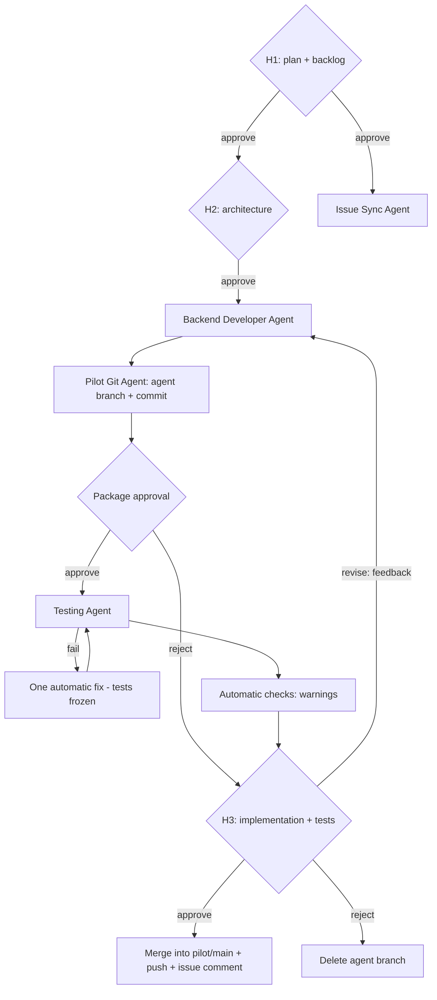

# AI Agent Organization

*Updated 7 November 2026 to match the code on `main`. Implemented and planned parts are marked separately.*

## 1. Purpose

This document describes the agents and supporting components of the AI-Supported End-to-End Software Development Workflow, how they work together, and where humans decide.

The pilot project is the **AI-Powered Adaptive Exam Preparation System**. The pilot is built only by the agents; the human only decides at the approval gates.

## 2. Organizational Principles

- **Centralized coordination:** the Orchestrator coordinates the workflow and checks the gates before any work is delegated.
- **Specialization:** each agent has one clear responsibility.
- **Validation:** generated tasks, architectures, patches and code are checked before the workflow advances.
- **Human oversight:** at each gate the human only decides — approve, revise, or reject. "Revise" means written feedback that an agent acts on; the human never edits the pilot by hand.
- **Two separate worlds:** the workflow (World 1, built by the student) and the pilot (World 2, built by the agents) never share a branch or a commit.
- **Traceability:** every agent action and every human decision is committed as a record, and pilot tasks are linked to GitHub Issues.
- **Safe rejection:** agents work on their own branches; rejecting simply deletes the branch.

## 3. Agents

| Agent | File | Status | Responsibility |
|---|---|---|---|
| Orchestrator | `agents/orchestrator.py` | Implemented | Requirement analysis, plan and backlog, task-ID validation, H1, gate checks before delegation, work packages, review of agent results |
| Software Architect | `agents/software_architect.py` | Implemented | Architecture document from the specification and approved tasks; task coverage is validated before H2 |
| Backend Developer | `agents/backend_developer.py` | Implemented | Structured JSON proposal (complete file contents) via Gemini; the patch is built locally; path whitelist and Python syntax checks; also writes fixes and H3 revisions |
| Testing | `agents/testing_agent.py`, `agents/testing_workflow.py` | Implemented | Runs pytest on the agent's tests in the pilot's own Python (no shell, time limit, no cache files); records command, exit code and output; never approves |
| Pilot Git Agent | `agents/pilot_git_agent.py` | Implemented | Creates `agent/<task>-attempt-N`, applies and commits patches as "AI-SDLC Backend Agent", commits run records, merges and pushes after H3 approval, deletes the branch after rejection; refuses the World 1 folder and hand-made changes |
| Issue Sync Agent | `agents/issue_sync_agent.py` | Implemented | After H1, creates one GitHub issue per approved task (label `world: pilot`, hidden task marker) and closes old generated issues as "not planned"; never touches World 1 issues |
| Frontend Developer | — | Planned (P2.2) | UI work for the pilot, after the UI stack is decided |
| Documentation | — | Planned (P2.3) | Pilot documentation from the approved architecture, accepted code and test results |
| DevOps / Deployment | — | Planned (P3.3, only if time allows) | Deployment and the H4 gate |

## 4. Supporting Components

| Component | File | Responsibility |
|---|---|---|
| Correction loop | `agents/correction_loop.py` | Tests → one automatic fix (tests frozen) → tests; H3 revisions; produces the `CorrectionLoopReport` |
| Pilot Environment | `agents/pilot_environment.py` | The pilot's own `.venv`; installs packages only after the human approves the list (asked again only when it changes); refuses pip options |
| Output validation | `agents/output_validation.py` | Automatic checks on the agent's code: imports vs requirements, unclosed resources. Warnings only, shown at H3 |
| H3 review | `agents/h3_review.py` | Shows the evidence, takes the human's decision, lets the agents carry it out; saves every decision as a record |
| Agent contracts | `agents/agent_contracts.py` | Pydantic models for agent results, so outputs are validated, not trusted |
| Ticket Quality Checker | `agents/ticket_quality_checker.py` | Checks task quality; not yet connected to the main flow |
| GitHub client | `integrations/github_client.py` | Reads, creates, comments on and closes issues |
| Main workflow | `main.py` | Command-line entry point; pilot workspace location; gate flow for each command |

## 5. Human Approval Gates

| Gate | Decision | Status |
|---|---|---|
| **H1** — plan and backlog | approve / revise / reject; the official backlog is the approved snapshot (17 tasks, T1–T17), task IDs frozen after H1 | Implemented |
| **H2** — architecture | approve / revise / reject, after automatic task coverage validation | Implemented — **known gap:** "revise" still asks the human to edit the architecture file by hand; it should send feedback to the Architect agent |
| **Package approval** — pilot environment | approve / reject the packages the agent declared | Implemented |
| **H3** — implementation and test evidence | approve (merge + push + issue comment) / revise (feedback → agent; the human decides whether tests may change) / reject (branch deleted) | Implemented (P1.6) |
| **H4** — deployment | — | Planned |

## 6. Workflow Diagram

Frontend, Documentation and DevOps agents and the H4 gate are planned and not shown.

## 7. Known Limits

- The legacy full run (`python main.py` without a flag) regenerates the backlog and overwrites the official snapshot; it is not aligned with the two-worlds design yet.
- H2 "revise" still relies on a manual edit (see section 5).
- Pilot issues are created with the student's GitHub token; each issue states that the Issue Sync Agent created it. A separate bot account or GitHub App is a possible later step.
- The automatic checks are heuristics: they can miss problems or warn without reason.
