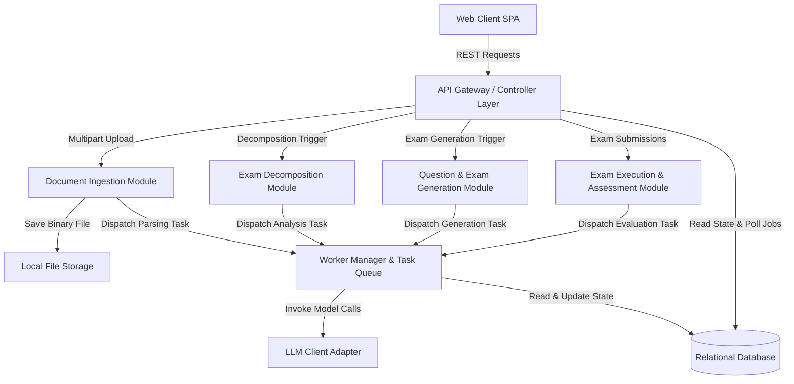
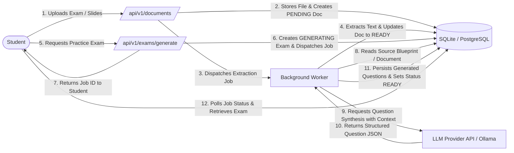

# System Architecture and Interface Design (T1)

## 1. Purpose

This document establishes the foundational system architecture, interface contracts, and persistence models for the AI-Powered Adaptive Exam Preparation System.

It addresses the acceptance criteria for Task T1:
- Architecture Decision Records (ADRs) are documented and approved: Addressed (documented in Section 2; awaiting human approval at H3).
- Component interaction diagrams and data flow diagrams are completed: Addressed (completed in Sections 3 and 4).
- OpenAPI specifications defining all service contracts are drafted: Not addressed because only 3 initial endpoints (/api/v1/documents, /api/v1/documents/{document_id}, and /api/v1/exams/generate) are drafted in pilot/app/backend/openapi_specs.py, so all service contracts are not yet fully defined.
- Initial database schema for users, uploads, and exams is created: Addressed (implemented in pilot/app/backend/models.py and pilot/app/backend/database.py, documented in Section 5).

---

## 2. Architecture Decision Records

### ADR-001: Architectural Style - Modular Monolith with Asynchronous Task Execution
- **Status**: Proposed - waiting for human approval at H3
- **Context**: The system is a proof-of-concept (PoC) requiring document ingestion, structure decomposition, AI synthesis, and assessment. These AI and PDF tasks take between 5 to 60 seconds. A microservices architecture introduces excessive operational complexity (multiple codebases, network boundaries, distributed tracing, complex CI/CD), whereas a purely synchronous monolith risks HTTP connection timeouts (such as HTTP 504).
- **Decision**: Adopt a Modular Monolith backend in Python with decoupled asynchronous background job execution and client polling.
- **Alternatives considered**:
  - *Distributed Microservices*: Rejected due to high overhead and premature complexity for a pilot project.
  - *Purely Synchronous Monolith*: Rejected because long-running LLM and parser calls block web worker threads and trigger gateway timeouts.
- **Consequences**: Enables simple single-repository maintenance and unified local testing while requiring background task workers and polling mechanisms for client responsiveness.

### ADR-002: Technology Stack and Relational Persistence
- **Status**: Proposed - waiting for human approval at H3
- **Context**: The backend needs asynchronous capabilities, rapid prototyping features, and strong integration with document processing libraries and relational storage. Early development requires zero-configuration setup for novice developers.
- **Decision**: Use Python 3.11+ with FastAPI for the web API layer, SQLAlchemy as the ORM, SQLite for local development and automated testing, and PostgreSQL for staging/production deployments.
- **Alternatives considered**:
  - *NoSQL / Document Stores (e.g., MongoDB)*: Rejected because relational integrity and ACID transactions are required across users, exams, blueprints, and questions.
  - *Node.js / Express or TypeScript*: Rejected due to less direct ecosystem support for mature Python-based PDF processing and LLM prompt libraries.
- **Consequences**: Developers can run unit tests locally with file-based SQLite without installing external database servers, while maintaining a clean migration path to PostgreSQL.

### ADR-003: LLM Integration and Structured Response Enforcement
- **Status**: Proposed - waiting for human approval at H3
- **Context**: The generation and evaluation modules interact with LLMs that can produce non-deterministic formatting or malformed outputs, breaking downstream processing.
- **Decision**: Use an abstraction layer (such as LiteLLM or Instructor) enforcing structured JSON schemas with automated validation and retry loops.
- **Alternatives considered**:
  - *Direct raw API calls without schema validation*: Rejected due to high risk of JSON parse failures and inconsistent data structures.
  - *Vendor-locked SDKs*: Rejected to preserve flexibility to switch between commercial APIs (such as OpenAI or Anthropic) and local self-hosted models (via Ollama).
- **Consequences**: Standardizes prompt execution across multiple model backends while ensuring reliable parsing into internal domain objects.

### ADR-004: Lexical Similarity Verification for Academic Integrity
- **Status**: Proposed - waiting for human approval at H3
- **Context**: Generated practice questions must test the same concepts as the source material without duplicating original exam questions verbatim.
- **Decision**: Implement algorithmic similarity verification (TF-IDF cosine similarity via scikit-learn) comparing synthesized questions against ingested documents, rejecting questions exceeding a 75% similarity threshold.
- **Alternatives considered**:
  - *Dedicated Vector Database with Neural Embeddings*: Rejected for the initial pilot as it adds unnecessary infrastructure overhead, external API costs, and operational complexity.
  - *No automated similarity checking*: Rejected because verbatim copying undermines pedagogical utility and violates academic guidelines.
- **Consequences**: Provides deterministic, zero-external-cost duplicate detection locally during generation workflows.

---

## 3. Component Interaction Diagram

---

## 4. Data Flow Diagram

---

## 5. Database Schema as Implemented

The supplied codebase (`pilot/app/backend/models.py` and `pilot/app/backend/database.py`) provides table definitions in both SQLAlchemy ORM format and raw SQLite DDL fallback. The initial persistence model implements three tables:

### 5.1. `users` Table
- `id` (VARCHAR(36), Primary Key): Unique identifier generated via `generate_uuid()`.
- `email` (VARCHAR(255), Unique, Not Null, Indexed): User email address.
- `password_hash` (VARCHAR(255), Nullable): Stored password hash for authentication.
- `created_at` (TIMESTAMP / DateTime, Not Null): Timestamp of user creation (UTC).

### 5.2. `documents` Table
- `id` (VARCHAR(36), Primary Key): Unique identifier generated via `generate_uuid()`.
- `user_id` (VARCHAR(36), Foreign Key `users.id`, Not Null, Indexed): Reference to owning user.
- `title` (VARCHAR(255), Not Null): Title or filename of the document.
- `doc_type` (VARCHAR(50), Not Null): Document category (for example `EXAM_SAMPLE`, `LECTURE_NOTE`, `SLIDE_DECK`).
- `storage_path` (VARCHAR(512), Nullable): File path on disk or storage volume.
- `parsed_text` (TEXT, Nullable): Plain text extracted from the document.
- `status` (VARCHAR(30), Not Null, Default `PENDING`): Processing state of the document.
- `created_at` (TIMESTAMP / DateTime, Not Null): Timestamp of record creation (UTC).

### 5.3. `generated_exams` Table
- `id` (VARCHAR(36), Primary Key): Unique identifier generated via `generate_uuid()`.
- `user_id` (VARCHAR(36), Foreign Key `users.id`, Not Null, Indexed): Reference to owning user.
- `source_blueprint_id` (VARCHAR(36), Nullable): Reference to source exam blueprint identifier.
- `title` (VARCHAR(255), Not Null): Practice exam title.
- `is_adaptive` (BOOLEAN, Not Null, Default `False`): Flag indicating if exam was adaptively generated.
- `status` (VARCHAR(30), Not Null, Default `GENERATING`): Exam lifecycle state.
- `created_at` (TIMESTAMP / DateTime, Not Null): Timestamp of exam creation (UTC).

---

## 6. Differences Between Architecture and Code

While the architecture specification outlines a complete end-to-end modular monolith, the codebase implemented under Task T1 represents the initial schema and contract foundations. The specific differences are:

1. **Additional Domain Entities Defined in Architecture but Not Yet Implemented in Code**:
   - The architecture specifies `exam_blueprints`, `questions`, `topics`, `exam_sessions`, `exam_answers`, and `longitudinal_mastery` tables.
   - In the code (`pilot/app/backend/models.py`), only `users`, `documents`, and `generated_exams` are currently implemented.
2. **OpenAPI Specification Scope**:
   - In `pilot/app/backend/openapi_specs.py`, the OpenAPI specification drafts endpoints for `/api/v1/documents`, `/api/v1/documents/{document_id}`, and `/api/v1/exams/generate`.
   - Complete service contracts for blueprint extraction, student submission grading, diagnostics, and study synthesis endpoints are planned for downstream tasks (T2 through T15) and have not yet been written in the code.
3. **Worker and Job Queue Execution**:
   - The architecture calls for an asynchronous task queue using Redis and RQ or Celery (or FastAPI background tasks).
   - The code does not yet instantiate a task worker daemon or in-memory job runner; it provides status strings and contract structures.
4. **Database Migration Tooling**:
   - The architecture anticipates production database migrations (such as Alembic).
   - The code currently uses direct `Base.metadata.create_all()` via SQLAlchemy or fallback raw SQLite `CREATE TABLE IF NOT EXISTS` execution in `init_db()`.

---

## 7. Open Questions

The following open questions remain from the approved architecture and the previous backend development report:

1. **Document Format & OCR Policy (Tasks T2, T4)**: Does the pilot need to support flat raster scans or smartphone photos requiring an optical character recognition (OCR) engine like Tesseract, or can it remain strictly restricted to digital-native text PDFs, DOCX, and PPTX files?
2. **LLM Provider Choice and Key Management (Tasks T3, T6, T8)**: Should local development default to open-weights models running via local Ollama instances or utilize shared commercial API keys (e.g., OpenAI or Anthropic)?
3. **Task Dependency Realignment for T13 and T14**: Task T14 (Longitudinal Performance Tracking Database) lists T13 (Diagnostics Dashboard) as a prerequisite in the project plan, but backend data persistence must exist prior to or concurrently with the UI visualization layer.
4. **Grading Feedback Granularity (Task T8)**: Should AI evaluation of open-ended and subjective student responses assign hard numerical point deductions, or should it offer qualitative rubric guidance and formative recommendations?
